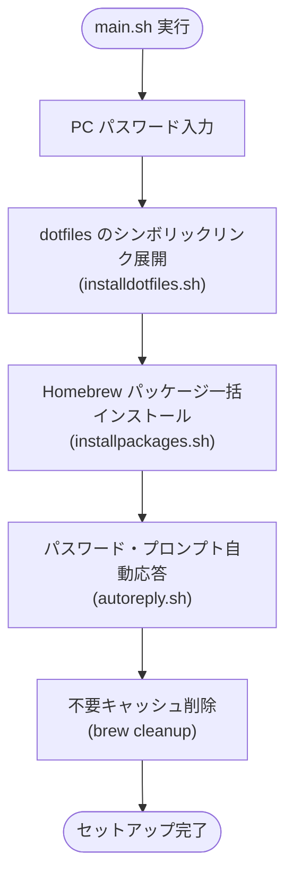

<!-- markdownlint-disable MD013 -->
# macintosh-setup-tool

[English](README.md) | [日本語](README-ja.md)

[](https://www.apple.com/macos/) [](https://www.zsh.org/) [](https://brew.sh/)

このツールは、macOS 環境の初期構築および設定管理を自動化するためのセットアップスクリプト群である。
CLI ツール、GUI アプリケーション、Mac App Store アプリの導入から dotfiles のシンボリックリンク展開までを一括して実行する。

## 特徴

### パッケージの一括インストール

Homebrew Bundle を活用し、CLI ツール（Formula）、GUI アプリ（Cask）、Mac App Store アプリ（mas）を自動導入する。

### 設定ファイル（dotfiles）の自動同期

リポジトリ内の dotfiles をホームディレクトリへシンボリックリンクとして展開し、設定の一元管理を可能にする。

### インタラクティブ操作の自動応答

`expect` スクリプトを利用してインストール時の管理者パスワード入力や確認プロンプトへの応答を自動化する。

## 処理フロー



## 事前準備

セットアップを実行する前に、以下の準備を完了しておく必要がある。

| 項目 | 説明 |
|------|------|
| App Store サインイン | Mac App Store アプリを導入するために App Store へのサインインを完了しておく。 |
| Homebrew 導入 | パッケージ管理ツールである Homebrew を事前にインストールしておく。 |

Homebrew のインストールコマンド：

```bash
/bin/bash -c "$(curl -fsSL https://raw.githubusercontent.com/Homebrew/install/HEAD/install.sh)"
```

## 使い方

### 一括実行

リポジトリ直下で `main.sh` を実行する。

```bash
./main.sh
```

実行時に管理者パスワード（PC パスワード）の入力が求められる。

### 個別実行

各スクリプトを単体で実行することも可能である。

#### dotfiles の展開のみ

```bash
./shellscripts/installdotfiles.sh
```

#### パッケージのインストールのみ

```bash
./shellscripts/installpackages.sh "<PC_PASSWORD>"
```

## ディレクトリ構成

| パス | 説明 |
|------|------|
| `main.sh` | セットアップ全体を実行するエントリーポイント |
| `shellscripts/installdotfiles.sh` | dotfiles をホームディレクトリにシンボリックリンク展開するスクリプト |
| `shellscripts/installpackages.sh` | Homebrew Bundle を実行してパッケージを導入するスクリプト |
| `shellscripts/autoreply.sh` | プロンプト入力に自動応答するための expect スクリプト |
| `resources/dotfiles/` | 管理対象の設定ファイル群（`.zshrc`、`.vimrc` 等） |
| `resources/homebrew/.Brewfile` | Homebrew で管理するパッケージ一覧定義 |
