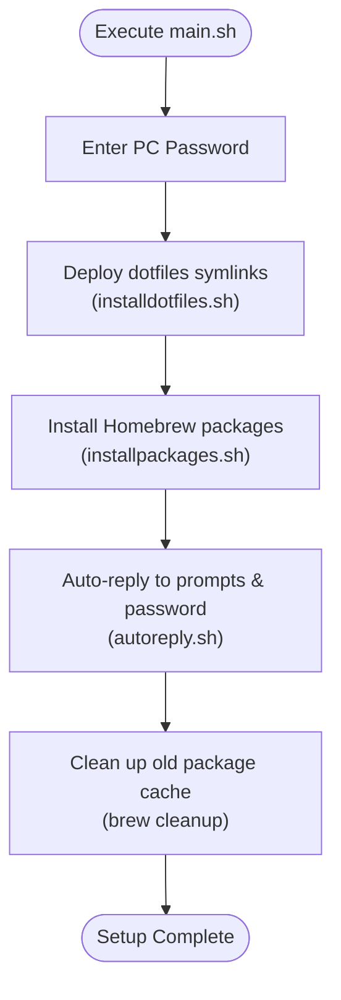

<!-- markdownlint-disable MD013 -->
# macintosh-setup-tool

[English](README.md) | [日本語](README-ja.md)

[](https://www.apple.com/macos/) [](https://www.zsh.org/) [](https://brew.sh/)

An automated environment setup and configuration management tool for macOS.
It streamlines initial machine setup by installing CLI utilities, GUI applications, Mac App Store apps, and deploying dotfiles symlinks in a single execution.

## Features

### Batch Package Installation

Leverages Homebrew Bundle to automatically install CLI tools (Formulae), GUI applications (Casks), and Mac App Store apps (mas).

### Automated Dotfiles Synchronization

Creates symlinks from the repository dotfiles to the home directory, ensuring centralized configuration management.

### Automated Prompt & Password Interaction

Uses `expect` scripts to automatically handle sudo password prompts and interactive confirmation dialogues during installation.

## Workflow



## Prerequisites

Before running the setup, ensure the following requirements are met:

| Requirement | Description |
|-------------|-------------|
| App Store Sign-in | Sign in to the Mac App Store to enable automated app installation via `mas`. |
| Homebrew Installation | Ensure Homebrew is installed on the machine. |

Homebrew installation command:

```bash
/bin/bash -c "$(curl -fsSL https://raw.githubusercontent.com/Homebrew/install/HEAD/install.sh)"
```

## Usage

### Complete Setup (Recommended)

Run `main.sh` from the repository root:

```bash
./main.sh
```

You will be prompted to enter your administrator (PC) password once at the start.

### Individual Execution

Each script can also be executed independently:

#### Deploy dotfiles only

```bash
./shellscripts/installdotfiles.sh
```

#### Install packages only

```bash
./shellscripts/installpackages.sh "<PC_PASSWORD>"
```

## Directory Structure

| Path | Description |
|------|-------------|
| `main.sh` | Entry point script that orchestrates the entire setup process |
| `shellscripts/installdotfiles.sh` | Script to symlink dotfiles to the home directory |
| `shellscripts/installpackages.sh` | Script to install packages defined in Homebrew Bundle |
| `shellscripts/autoreply.sh` | Expect script to handle interactive prompts automatically |
| `resources/dotfiles/` | Configuration files to be deployed (`.zshrc`, `.vimrc`, etc.) |
| `resources/homebrew/.Brewfile` | Homebrew Bundle file defining formulae, casks, and mas apps |
